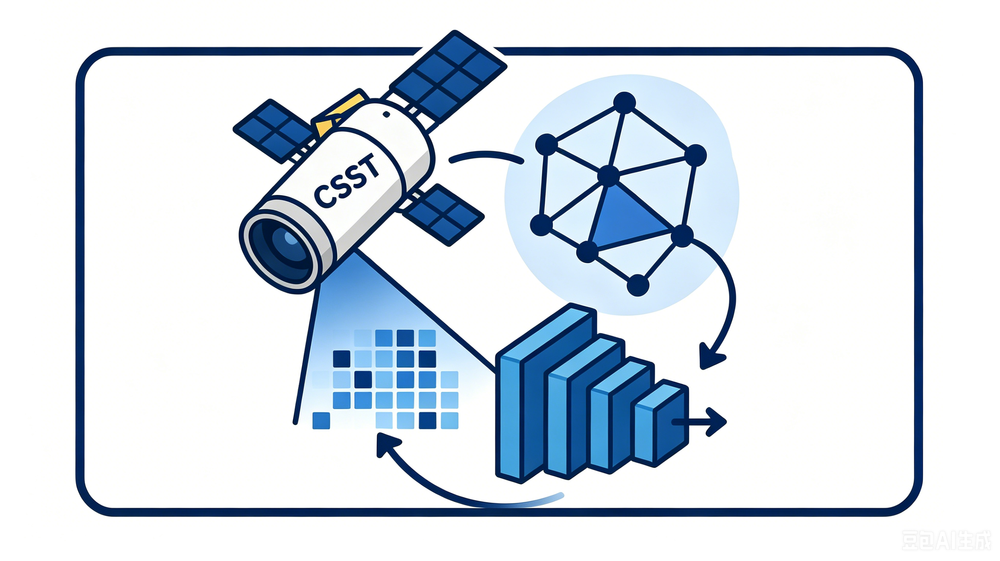

# CSST-TDA-CNN

在这里我们使用拓扑数据分析（TDA）以及卷积神经网络（CNN）对 CSST 中的二维光谱 + 多波段图像进行分类。

---

## 🧠 方法框架

---

## 主要解决两个问题：

### 1. 低分辨率 + 高噪声
使用拓扑数据分析（TDA）提取图像的全局结构信息（持久图 → 持久性特征），构建对噪声鲁棒的拓扑描述符，从而增强对弱信号结构的识别能力。

### 2. 类别严重不平衡
在拓扑特征空间中引入 SMOTE（Synthetic Minority Over-sampling Technique），对少数类（如恒星样本）进行合成扩展，从而缓解类别偏置问题并提升分类器泛化能力。

---

## 🔬 Pipeline Overview

本方法整体流程如下：

- CSST二维光谱 / 图像输入
- TDA特征提取（Betti / Entropy / Landscape / Amplitude）
- 特征拼接（GI / GV / 原图 / 反转图）
- SMOTE平衡样本分布
- CNN / 分类器训练
- 输出分类结果（星系 vs 恒星）

---

## 📊 Feature Representation

我们从每个源提取 656 维拓扑特征，包括：

- Betti curves（拓扑结构强度）
- Persistence entropy（复杂度）
- Persistence landscape（多尺度形态）
- Amplitude（稳定性）

---

